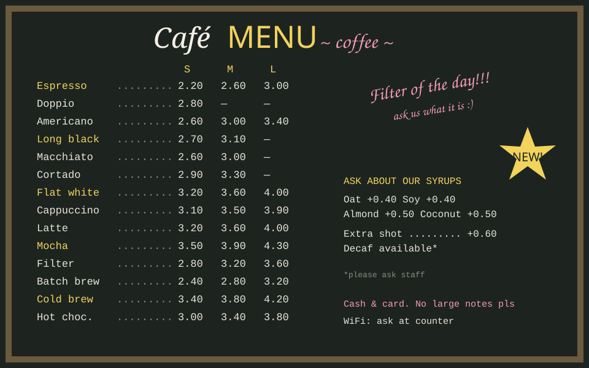
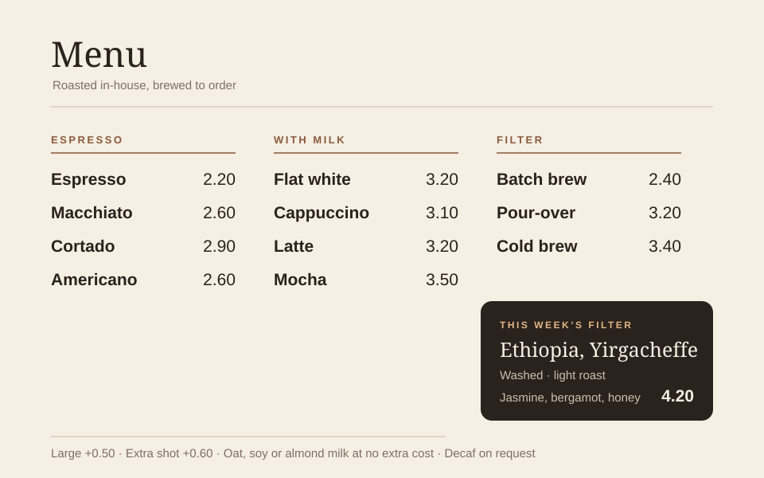

> [!info] Demo: annotated case study
> A fictional redesign, written to show the format. **Hover or tap the numbered pins** to see what each part of the image is about; the matching note lights up beside it. **Drag the divider** on the before/after image to compare. Placeholder content: the café and its menu are made up.

## The brief

A small café's menu board had grown by accretion: every new drink, price change and special was added wherever there was space. Regulars ordered by memory; newcomers stood at the counter reading for a long time, and the queue grew behind them.

The goal was a board a first-time customer can read in the time it takes to reach the counter.

## What was wrong

> [!pins] 
>
> - 60, 8: Three typefaces in one heading. Each competes for attention before you've read a single drink.
> - 39, 21: Three sizes on every row turn 14 drinks into 42 prices to scan.
> - 13, 52: One long list in menu-card order. Nothing groups the drinks the way customers think about them.
> - 73, 22: "Filter of the day!!!" is the loudest thing on the board, but it doesn't say what the filter is.
> - 70, 56: Milk options, extras and payment notes are scattered across the right-hand side.

## The redesign

> [!compare] Before | After
> 
> 

## The decisions

> [!pins] 
>
> - 9, 12: A quiet header. The drinks, not the sign, carry the personality.
> - 48, 29: Three groups that match how people decide: a straight espresso, something with milk, or filter.
> - 31, 44: One price per drink, right-aligned in a single column, so prices read as a list rather than a grid.
> - 78, 70: A single featured filter with its origin and tasting notes, written the way a barista would describe it.
> - 30, 95: Sizes, extras and milk options become one line of small print instead of a column on every row.

The featured coffee is where the menu can teach a little. Naming the origin and process gives customers words for what they're tasting, and it borrows directly from how the garden describes [[Terroir|terroir]] and [[Processing methods|processing]].

## What we'd measure

This case is fictional, so there are no results to report. A real project would time newcomers from the door to their order before and after the change, and count how often staff are asked "what's the filter today?".

> [!example]- How this page is written
> Pins are a callout whose title is the image, with one note per line starting with its position in percent (left, top):
>
> ```md
> > [!pins] 
> >
> > - 48, 29: Three groups that match how people decide…
> ```
>
> The slider is a callout with two images and the two labels in its title:
>
> ```md
> > [!compare] Before | After
> > 
> > 
> ```
>
> The page opts in with `demo: [case-study]`.
